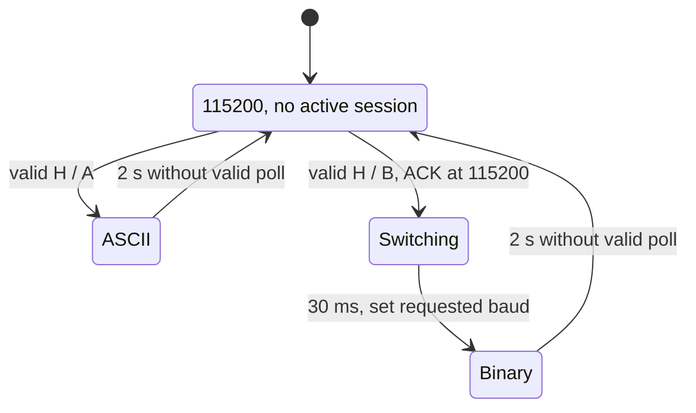

# PulseBridge protocol 3

Protocol 3 is the default host/firmware contract. Explicit legacy1/legacy2 adapters are available for migration, with no automatic downgrade. It deliberately rejects old v1/v2 replies. The layout stays **14 request bytes / 34 response bytes**; the version and control/ASCII formats change together. All multibyte binary fields are **little endian**, explicitly serialized in C++, unpacked with cached `<` structs in Python. No compiler struct padding or native endianness is used.

## Profiles and handshake

| Profile | Initial baud | Session format | Session baud | Default steady/warmup rate |
|---|---:|---|---:|---|
| compat | 115200 | ASCII v3 | 115200 | 20 / 100 requests/s |
| demo (paced fast alias) | 115200 | Binary v3 | 460800 | 100 / unpaced |
| fast | 115200 | Binary v3 | 460800 | unpaced / unpaced |
| turbo (experimental) | 115200 | Binary v3 | 921600 | unpaced / unpaced |

Workstation `--rate` applies to **both** warmup and steady phases. In the small `pi/app.py` dashboard, set `--warmup-rate` explicitly if overriding the steady rate. Benchmark rate applies identically to both phases. Baud overrides must match the selected profile. On native Hardware CDC, baud is just a logical profile label; it is not the USB transport bit rate.

Host opens at 115200, deasserts DTR/RTS, waits at least **2.2s** for previous-session idle recovery/board boot, clears host input and sends newline. It creates a fresh random uint32 nonce on every connection. ASCII control lines have `body*HHHH\n`, CRC over body only, four hexadecimal CRC digits; optional CR before LF is tolerated.

```
H,3,NONCE,MODE,BAUD,SEED*CRC
A,3,NONCE,MODE,BAUD,BOOT,BOARD_PROFILE*CRC
```

NONCE/BOOT are exactly eight hex digits. MODE is A or B. A requires 115200; B permits 460800/921600. SEED is uint32 decimal: zero retains device entropy; nonzero resets PRNG, per-symbol counters and sequence for reproducible session workloads. Boot ID remains the device's boot identity. BOARD_PROFILE is 1..5 as listed in START_HERE.

The device accepts a new handshake only while no session is active. It sends the ACK at base speed, flushes control output, waits 30ms in binary negotiation only, then switches UART baud. Host validates ACK CRC/version/nonce/mode/baud/boot/profile, changes its baud, waits 80ms and clears partial parsers before polling. Handshake timeout is 1s. An ACK is not a data sample.



## Binary request, 14 bytes

| Offset | Bytes | Field | Allowed value |
|---:|---:|---|---|
| 0 | 2 | Magic | ASCII PB, hex 50 42 |
| 2 | 1 | Version | 3 |
| 3 | 1 | Kind | 1 (poll) |
| 4 | 4 | Nonce | Active negotiated uint32 session |
| 8 | 4 | Request ID | uint32; advancing modular order |
| 12 | 2 | CRC | CRC of bytes 0..11, low byte first |

## Binary response, 34 bytes

| Offset | Bytes | Field | Allowed value |
|---:|---:|---|---|
| 0 | 2 | Magic | PB |
| 2 | 1 | Version | 3 |
| 3 | 1 | Kind | 2 (data) |
| 4 | 4 | Nonce | Echo active session |
| 8 | 4 | Request ID | Echo poll |
| 12 | 4 | Boot ID | Random uint32 once per boot |
| 16 | 4 | Sequence | uint32, increments only for new accepted request |
| 20 | 4 | ESP timestamp | Low uint32 `micros()` at data generation |
| 24 | 4 | Movement | Signed int32; units 0.0001 percentage points |
| 28 | 1 | Symbol ID | 0 RELIANCE, 1 TCS, 2 INFY, 3 HDFCBANK, 4 ITC, 5 LT |
| 29 | 1 | Flags | Exactly 1: device-generated SYNTHETIC demo data |
| 30 | 2 | Reserved | Exactly zero |
| 32 | 2 | CRC | CRC of bytes 0..31, low byte first |

10000 movement units = 1.0000 percent. The decoder accepts ±1,000,000 units (±100 percent); the generator uses a smaller demonstration range. Unknown version/type/flags/reserved bytes/symbols/range are rejected even if the CRC is valid.

## ASCII polls and replies

```
P,3,NONCE,REQUEST*CRC
D,3,NONCE,REQUEST,BOOT,SEQUENCE,ESP_MICROS,SYMBOL_ID,MOVEMENT,1,0*CRC
```

Decimal uint32 fields contain only digits, up to ten, no sign. Signed movement permits minus only. Symbol is a single digit 0..5. Response flag/reserved decimal fields are exactly 1,0. Every accepted decoded packet contains `source: SYNTHETIC`, `protocol_version: 3`, symbol ID and name. Compatibility mode has the same identity/cache/replay rules as binary mode.

`INFO\n` returns a diagnostic comment only in base/ASCII mode. `STATS\n` returns:

```
S,3,BOOT,CRC_ERRORS,FRAMING_ERRORS,REJECTED,DUPLICATES,RESETS,ACCEPTED,TX_ERRORS*CRC
```

Device counters are cumulative uint32 values (modulo wrap); ACCEPTED excludes cache hits. Host doctor reports them in compat mode. They are diagnostics on demand, **not** continuously polled in the measured path; host errors and device errors are separate populations. A CRC failure, semantic rejection or wrong nonce does not refresh idle expiry. No text logs are injected in binary mode.

## CRC vectors

CRC-16/CCITT-FALSE: width 16, polynomial 0x1021, init 0xFFFF, RefIn=false, RefOut=false, XorOut=0. Empty input → FFFF; ASCII `123456789` → **29B1**. Binary CRC stored LE; ASCII CRC printed hex. The bitwise firmware implementation is retained: a lookup table was not justified by target profiling.

| Vector | Exact bytes/text |
|---|---|
| Request nonce 12345678, ID 1 | `504203017856341201000000472a` |
| Response boot AABBCCDD, seq 7, ESP micros FFFFFFFE, −20000 units, symbol 2 | `504203027856341201000000ddccbbaa07000000feffffffe0b1ffff020100003408` |
| Handshake | `H,3,12345678,B,460800,42*B4A3` followed by LF |
| ASCII equivalent response | `D,3,12345678,1,AABBCCDD,7,4294967294,2,-20000,1,0*4DE7` followed by LF |

`tests/native_protocol.cpp` calls the actual sketch CRC and packet code through test-only Arduino/driver shims; Python tests compare bytes/fields, seed reproducibility, all input fragments, concatenation, corruption, stale nonce/request, cache replay and idle fallback. This does not compile Espressif drivers or establish target timing.

## Identity, replay and recovery

- Firmware caches only the most recent accepted request/response. Repeating exactly that request returns identical bytes/timestamp/sequence and does not advance the generator. Older/out-of-order requests and wrong-session nonces are rejected. A new ID is forward iff uint32 `(new-old)` lies in 1..0x7fffffff. Thus max→0 rollover works; jumps of half the range or more are rejected.
- Host accepts only current nonce/request and the boot ID negotiated in the ACK. Same-boot sequence differences use the same modular rule; zero/backward rejects, forward gaps are counted. Host tracks successful reconnects and boot changes separately. Fresh sessions reset host sequence tracking (needed when a deterministic seed resets device sequence).
- Nonces/boot IDs are probabilistic uint32 identities, **not authentication**. CRC is error detection, not protection against malicious devices. Only a trusted physical link is in scope.
- Firmware binary parser uses a 14-byte circular candidate with bounded copying and no `memmove` or heap allocation. CRC-invalid candidates slide one byte; valid but wrong-session packets are consumed/rejected. The 96-byte text buffer discards overflow through newline. Each receive service drains at most 64 bytes.
- UART0 blocks for one byte (up to 20 RTOS milliseconds), then reads only bytes already buffered. RX FIFO threshold is 14 and RX timeout one UART symbol. Waiting for the *first* byte does not intentionally delay an available packet. Native CDC uses buffered reads and a 1ms idle yield. Every 10ms of busy servicing yields to scheduling/watchdogs. No blind priority increase or busy spin.
- Host reads at most 4096 bytes per call. Binary parsing is one offset scan with a <34-byte retained tail; ASCII retains at most 191 bytes. Oversized external parser input is truncated to the last 4096 bytes with an explicit overflow counter. Real serial callers already obey the bound.
- Per-request timeout defaults to 250ms; select waits at most 50ms and wakes on readiness. Timeout resets host partial parsers. Three consecutive timeouts close/reopen the port, wait for idle expiry, and handshake a fresh session. Idle >2s restores firmware base baud/mode/cache/parser; boot identity and cumulative counters survive.
- Deliberately slow controlled rates that exceed link idle duration trigger a fresh handshake outside the next timed sample; the resynchronization is counted. Use ≥1 request/s or closed-loop for stable throughput comparisons.
- `micros()` wraps every 2^32 microseconds (~71.6min); it is metadata only. `millis()` idle subtraction is unsigned/modular (~49.7-day wrap). Sequence/request IDs also wrap. No unsynchronized ESP/Pi timestamp subtraction occurs.

## Consolidated release additions

The configured `--board-profile` must equal the profile in the CRC-valid ACK before accepting data. Repeated connection failures back off 1, 2, 4, 8, then 16 seconds; a valid response resets the backoff. `protocol-sim` runs a Linux PTY fixture through this same parser, with `connection_kind=software_fixture` and `SIMULATED` UI status. It cannot establish USB latency. A hardware-mode run with no valid replies, a failed receiver or a disconnected final state exits nonzero. Shutdown separately records process exit status, accepted-response status and acquisition/engine counts.

Legacy1: archived standard sketch, ASCII v1 at 115200, no v3 handshake. Legacy2: archived Fast sketch, binary v2 with 230400 control baud and 460800/921600 data profiles. Their wire versions are deliberately rejected by v3. The legacy standard INFO baud has been corrected to 115200. Legacy paths do not add v3 identity protections to old firmware.
